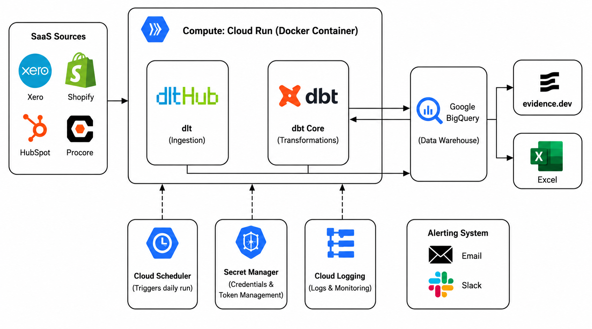

# Multi-Source SaaS ELT Pipeline & BI Dashboard

A code-first data pipeline integrating **HubSpot**, **Xero**, **Shopify**, and **Procore** into **Google BigQuery** (Cloud) and **PostgreSQL** (Local), modeled with `dbt Core` and visualized using `Evidence.dev`.



---

## Operational Context

### The Fictional Business
A modular storage, millwork, and outdoor-structures manufacturer that sells kits online through Shopify, sells to builders and dealers through HubSpot, and installs larger orders on site.

### System Roles
* **Shopify**: Direct-to-consumer (D2C) e-commerce storefront for modular storage and joinery kits.
* **HubSpot CRM**: Inbound pipeline, quotes, and contract management for regional builders and dealer networks.
* **Procore (Field Delivery & Transition to Wrike)**: 
  Originally adopted to manage onsite installation delivery. Because Procore is built for general contractors, it is heavy for a company whose real work is production, marketing launches, and install scheduling. The company is actively migrating project operations to Wrike.
  * **Why active data remains in Procore**: Active install jobs stay in Procore until closeout because moving in-flight RFIs, submittals, and change orders mid-project introduces operational risk.
  * **Closed projects**: Remain in Procore as the historical system of record for warranty claims and audit trails.
  * **New projects**: Scheduled and launched in Wrike.
* **Xero**: Financial system of record for progress billings, accounts receivable aging, and invoice payment collections.

### Customer and Project Mapping
Because SaaS tools generate independent primary keys, `seed_project_mapping.csv` functions as a lookup table:
It maps the real customer accounts extracted from Xero (such as *Ridgeway University* and *Hamilton Smith Ltd*) to their corresponding Procore installation codes (*PRJ-1000*, *PRJ-1001*) and operational business units.

```text
HubSpot Deal (Contract Booking)
       │
       ▼
Procore Project (Field Delivery & Milestones)
       │
       ▼
Xero Invoices (Progress Billings & Cash Collection)
       │
       ▼
Shopify Orders (Parallel D2C Channel)
```

### Data Sources & Coverage

| System | Role in Business | Extracted Entities | Data Origin |
| :--- | :--- | :--- | :--- |
| **HubSpot CRM** | Inbound leads, contracts & pipeline | Deals, Companies, Contacts | Live API + Backfill |
| **Procore** | Construction & project delivery | Projects, Companies, Users | Live API + Backfill |
| **Xero** | Progress billings & receivables | Invoices, Contacts, Line Items | Live API + Backfill |
| **Shopify** | Online modular storage & joinery kits | Products, Variants, Orders | Live API |

* **Data Coverage**: Real SaaS API records start from **June 2026**. Pre-June 2026 history is backfilled using phased project estimates tied to the 14 client accounts in `seed_project_mapping.csv`.

---

## Repository Structure

```text
.
├── .agents/             # Agent rules and coding guidelines
├── .dlt/                # Pipeline toggles and credentials (git-ignored)
├── dbt_transform/       # dbt models, macros, seeds, and schema tests
├── deploy/              # Cloud deployment configs (Cloud Monitoring alert policy)
├── docs/                # Architecture docs, runbooks, and diagrams
├── evidence_dashboard/  # Evidence.dev dashboard (pages, components, queries)
├── runners/             # Python execution orchestrators (parallel run_all.py)
├── scripts/             # Helper scripts (OAuth fix, secret deployment, seed data)
├── sources/             # dlt source extractors (HubSpot, Xero, Shopify, Procore)
├── utils/               # Shared helpers (retry handler, logger, secret manager, Slack notifier)
├── Dockerfile           # Container specification for local Docker or Cloud Run execution
├── pipeline.sh          # Unified entrypoint CLI
└── README.md            # Repository documentation
```

---

## Quick Start & Usage

### 1. Environment Setup

```bash
python3 -m venv .venv
source .venv/bin/activate
pip install poetry
poetry install
cp .dlt/secrets.toml.example .dlt/secrets.toml
```

### 2. Unified Pipeline CLI (`pipeline.sh`)

All local and cloud operations are managed through `./pipeline.sh`:

```bash
# Ingestion & Modeling
bash pipeline.sh run dev                            # Full local ELT (APIs -> Postgres -> dbt)
bash pipeline.sh run prod                           # Trigger remote Cloud Run Job on GCP
bash pipeline.sh dbt dev                            # Run dbt against Local Postgres (skip ingestion)
bash pipeline.sh dbt prod                           # Validate models against BigQuery

# BI Dashboard (Evidence.dev)
bash pipeline.sh dashboard dev                      # Launch dev server on Local Postgres
bash pipeline.sh dashboard prod                     # Launch dev server on live BigQuery

# Cloud Deployments (GCP)
bash pipeline.sh deploy job                         # Build Docker image & update Cloud Run Job
bash pipeline.sh deploy dashboard                   # Deploy AI Copilot, sync BigQuery & verify build
bash pipeline.sh deploy all                         # Deploy both ingestion job and dashboard
bash pipeline.sh auth                               # Re-authorize SaaS OAuth tokens & sync to GCS
```

---

## Analytical Marts Inventory

| Model | Layer | Description |
| :--- | :--- | :--- |
| `fct_executive_cockpit` | Mart | Monthly cash flow, realized gross profit, margin fade, cycle time, and diagnostic health flags |
| `fct_revenue` | Mart | Granular billing transactions with calendar dimensions and data origin tracking |
| `fct_pipeline` | Mart | CRM deal stages, pipeline amounts, and win/loss reasons |
| `dim_projects` | Mart | Unified project directory across active Procore jobs and historical phases |
| `dim_customers` | Mart | Customer records deduplicated across CRM and accounting |
| `dim_products` | Mart | Shopify product catalog, variants, and pricing |

---

## Executive BI Dashboard (`Evidence.dev`)

Built with Evidence.dev, featuring 3 operational pages with 21 automated data quality tests passing across both PostgreSQL (`dev`) and Google BigQuery (`prod`):

### 1. Executive Cockpit (`/overview`)
* **Monthly Cash Flow**: Billed revenue (Xero) vs. job costs (Procore) vs. realized gross profit line.
* **Margin Fade**: Sold quote margin benchmark vs. actual realized gross margin with auto-scaled variance tracking.
* **Forward Demand & Backlog**: Weighted CRM pipeline (HubSpot) vs. unbilled delivery schedule (Procore), reactive to MTD/QTD/YTD slicers.
* **Lead to Cash Cycle Time**: Dynamic cycle days by business unit modulated by seasonal throughput factors.
* **Diagnostic Health Flags**: Overdue accounts receivable (Xero), stalled deals (HubSpot), and active unbilled delivery backlog (Procore).
* **AI Copilot Diagnostic Card**: Serverless Cloud Function Gen 2 proxy using Gemini 2.5 Flash with read-only BigQuery access and pre-warmed cache for KPI drill-downs.

### 2. Sales & Win-Loss (`/sales`)
* Deal stage conversion rates, loss reason breakdown, and top client concentration.

### 3. Operations & Delivery (`/operations`)
* Procore project status tracking, active unbilled WIP completion, and Shopify inventory pricing.

---

## Execution Modes & Known Gaps

* **Local Development**: Runs via Python or Docker against PostgreSQL.
* **Cloud Execution**: Containerized job on GCP Cloud Run executed via `pipeline.sh cloud` loading to BigQuery.

### Roadmap
- [ ] **Infrastructure as Code**: Provision Cloud Run, Cloud Scheduler, and GCS using Terraform instead of manual `gcloud` CLI commands.
- [ ] **Automated CI/CD**: Automate container image build and Cloud Run job updates on git push (currently deployed via CLI).
- [ ] **Python Orchestrator**: Replace the bash runner (`pipeline.sh`) with a Python runner for cleaner error handling and alerts.
