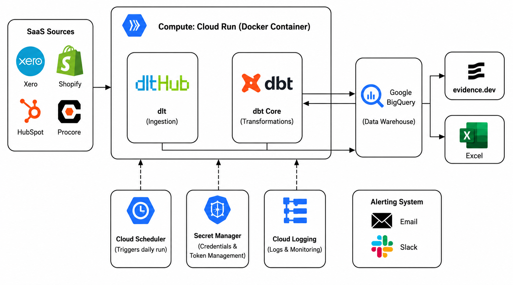

# Multi-Source SaaS ELT Pipeline & BI Dashboard

A code-first data pipeline integrating **HubSpot**, **Xero**, **Shopify**, and **Procore** into **Google BigQuery** (Cloud) and **PostgreSQL** (Local), orchestrated with `Dagster`, modeled with `dbt Core`, provisioned with `Terraform`, and visualized using `Evidence.dev`.



---

## Operational Context

This consolidates real-world architectures from multiple real life projects (cross-SaaS reconciliation, ephemeral token vaults, BigQuery dbt modeling, and version-controlled BI dashboard development, ...) into a single showcase project.

### The Business Scenario
A modular storage, millwork, and outdoor-structures manufacturer that sells kits online through Shopify, sells to builders and dealers through HubSpot, and installs larger orders on site.

### System Roles
* **Shopify**: Direct-to-consumer (D2C) e-commerce storefront for modular storage and joinery kits.
* **HubSpot CRM**: Inbound pipeline, quotes, and contract management for regional builders and dealer networks.
* **Procore (Field Delivery & Transition to Wrike)**: 
  Originally adopted to manage onsite installation delivery. Because Procore is built for general contractors, it is heavy for a company whose real work is production, marketing launches, and install scheduling. The company is actively migrating project operations to Wrike.
  * **Why active data remains in Procore**: Active install jobs stay in Procore until closeout because moving in-flight RFIs, submittals, and change orders mid-project introduces operational risk.
  * **Closed projects**: Remain in Procore as the historical system of record for warranty claims and audit trails.
  * **New projects**: Scheduled and launched in Wrike.
* **Xero**: Financial system of record for progress billings, accounts receivable aging, and invoice payment collections.

### Customer and Project Mapping
Because SaaS tools generate independent primary keys, `seed_project_mapping.csv` functions as a lookup table:
It maps the real customer accounts extracted from Xero (such as *Ridgeway University* and *Hamilton Smith Ltd*) to their corresponding Procore installation codes (*PRJ-1000*, *PRJ-1001*) and operational business units.

```text
HubSpot Deal (Contract Booking)
       │
       ▼
Procore Project (Field Delivery & Milestones)
       │
       ▼
Xero Invoices (Progress Billings & Cash Collection)
       │
       ▼
Shopify Orders (Parallel D2C Channel)
```

### Data Sources & Coverage

| System | Role in Business | Extracted Entities | Data Origin |
| :--- | :--- | :--- | :--- |
| **HubSpot CRM** | Inbound leads, contracts & pipeline | Deals, Companies, Contacts | Live API + Backfill |
| **Procore** | Construction & project delivery | Projects, Companies, Users | Live API + Backfill |
| **Xero** | Progress billings & receivables | Invoices, Contacts, Line Items | Live API + Backfill |
| **Shopify** | Online modular storage & joinery kits | Products, Variants, Orders | Live API |

* **Data Coverage**: Real SaaS API records start from **June 2026**. Pre-June 2026 history is backfilled using phased project estimates tied to the 14 client accounts in `seed_project_mapping.csv`.

---

## Repository Structure

```text
.
├── .agents/             # Agent rules and coding guidelines
├── .dlt/                # Pipeline toggles and credentials (git-ignored)
├── dbt_transform/       # dbt models, macros, seeds, and schema tests
│   └── models/
│       ├── staging/     # Raw source cleaning & typecasting (hubspot, xero, shopify, procore)
│       ├── intermediate/# Cross-source deduplication & unified revenue streams
│       └── marts/       # Analytical facts & dimensions for BI reporting
├── deploy/              # Cloud deployment configs (AI Copilot proxy & alert policies)
├── docs/                # Architecture docs, runbooks, and diagrams
├── evidence_dashboard/  # Evidence.dev dashboard (pages, components, queries)
├── infra/               # Terraform IaC (BigQuery datasets w/ 7-day dev TTL, Cloud Run, IAM, GCS)
├── orchestration/       # Dagster asset graph & job definitions
├── runners/             # Python execution orchestrators (parallel run_all.py)
├── scripts/             # Helper scripts (verify_security.py, Copilot DuckDB export, OAuth fix)
├── sources/             # dlt source extractors (HubSpot, Xero, Shopify, Procore)
├── utils/               # Shared helpers (retry handler, logger, secret manager, Slack notifier)
├── Dockerfile           # Container specification for local Docker or Cloud Run execution
├── pipeline.sh          # Unified entrypoint CLI
└── README.md            # Repository documentation
```

---

## Quick Start & Usage

### 1. Environment Setup

```bash
python3 -m venv .venv
source .venv/bin/activate
pip install poetry
poetry install
cp .dlt/secrets.toml.example .dlt/secrets.toml
```

### 2. Unified Pipeline CLI (`pipeline.sh`)

All local and cloud operations are managed through `./pipeline.sh`:

```bash
# Local ELT, Dagster UI & Modeling
bash pipeline.sh verify                       # Run all 6 pre-push verification gates against BigQuery dbt_dev
bash pipeline.sh dagster <local|dev|prod>     # Launch Dagster Asset UI on http://127.0.0.1:3001
bash pipeline.sh run local                    # Full local ELT (APIs -> Postgres -> dbt local)
bash pipeline.sh dbt <local|dev|prod>         # Run dbt models (Postgres local, BigQuery dbt_dev, or dbt_prod)
bash pipeline.sh dbt-clone                    # Zero-copy clone BigQuery dbt_prod into dbt_dev (--full-refresh)

# BI Dashboard (Evidence.dev)
bash pipeline.sh dashboard <local|dev|prod>   # Launch Evidence dev server (auto-refreshes on target change)
bash pipeline.sh dashboard prod --build --skip-sources  # Fast static build & preview without re-querying BQ
bash pipeline.sh dashboard prod --build --base-path     # Preview with exact GitHub Pages /<repo>/ subpath

# Staging Verification, Cloud Job & OAuth
bash deploy/deploy_all.sh                     # Verify gates on dbt_dev (or pass --prod for dbt_prod)
bash pipeline.sh deploy job                   # Build Docker image & update Cloud Run ingestion job
bash pipeline.sh auth                         # Re-authorize SaaS OAuth tokens & sync to GCS
```

---

## Analytical Marts Inventory

| Model | Layer | Description |
| :--- | :--- | :--- |
| `fct_executive_cockpit` | Mart | Monthly cash flow, realized gross profit, margin fade, cycle time, and diagnostic health flags |
| `fct_revenue` | Mart | Granular billing transactions with calendar dimensions and data origin tracking |
| `fct_pipeline` | Mart | CRM deal stages, pipeline amounts, and win/loss reasons |
| `dim_projects` | Mart | Unified project directory across active Procore jobs and historical phases |
| `dim_customers` | Mart | Customer records deduplicated across CRM and accounting |
| `dim_products` | Mart | Shopify product catalog, variants, and pricing |

---

## Executive BI Dashboard (`Evidence.dev`)

Built with Evidence.dev, featuring a white-label header component (`DashboardHeader.svelte`), automated URL routing & slicer state tests (`npm run test:url`), and 3 operational pages backed by 21 automated dbt data quality tests across PostgreSQL (`local`) and Google BigQuery (`dev` / `prod`):

### 1. Executive Cockpit (`/overview`)
* **Monthly Cash Flow**: Billed revenue (Xero) vs. job costs (Procore) vs. realized gross profit line.
* **Margin Fade**: Sold quote margin benchmark vs. actual realized gross margin with auto-scaled variance tracking.
* **Forward Demand & Backlog**: Weighted CRM pipeline (HubSpot) vs. unbilled delivery schedule (Procore), reactive to MTD/QTD/YTD slicers.
* **Lead to Cash Cycle Time**: Dynamic cycle days by business unit modulated by seasonal throughput factors.
* **Diagnostic Health Flags**: Overdue accounts receivable (Xero), stalled deals (HubSpot), and active unbilled delivery backlog (Procore).
* **AI Copilot Diagnostic Card**: Serverless Cloud Function Gen 2 proxy using Gemini 3.5 Flash Lite with in-memory DuckDB analytical querying, zero server logging, and pre-warmed cache for KPI drill-downs.

### 2. Sales & Win-Loss (`/sales`)
* Deal stage conversion rates, loss reason breakdown, and top client concentration.

### 3. Operations & Delivery (`/operations`)
* Procore project status tracking, active unbilled WIP completion, and Shopify inventory pricing.

---

## Execution Modes & Known Gaps

* **Local Development**: Runs via Python, Dagster UI (`http://127.0.0.1:3001`), or Docker against PostgreSQL (`local`) or BigQuery (`dbt_dev` via `dbt clone`).
* **Cloud Execution**: Daily Cloud Scheduler triggers a one-shot GCP Cloud Run Job (`pipeline.sh cloud`) executing the Dagster `prod_pipeline_job` (`dlt` -> `dbt build` -> GCS `manifest.json` & AI Copilot DuckDB/cache upload -> Slack summary).
* **CI/CD & Security Gates**: GitHub Actions (`deploy-dashboard.yml`) enforces `gitleaks` secret scanning, `scripts/verify_security.py`, `dbt clone` Slim CI, and `npm run test:url` with path-scoped jobs so UI-only changes skip warehouse and backend builds.

### Dual-Engine Support (PostgreSQL & BigQuery)

This pipeline is configured to run against **local PostgreSQL** (`local`) and **Google BigQuery** (`dev` / `prod`) from a single codebase:
* **Why**: Validates that the `dlt` + `dbt` template is portable across both relational databases (for smaller deployments) and cloud columnar warehouses, while allowing local `dbt` runs to finish in ~3 seconds instead of waiting on cloud API latency.
* **Cross-Dialect Mechanics**: Uses `dbt.type_*()` macros for type casting, `generate_surrogate_key()` for cross-engine hashing (`MD5` vs `TO_HEX(MD5)`), and dynamic source schema routing (`_raw` vs `_data`).
* **When to Pivot**: Supporting two SQL engines requires avoiding native BigQuery functions (`UNNEST`, `SAFE_CAST`) and adds dialect testing overhead. For teams committed strictly to BigQuery, `dev` should target an isolated BigQuery dataset (`dbt_dev` or ephemeral PR schemas) to guarantee 100% dialect parity, or use **DuckDB** (`dbt-duckdb`) for local OLAP execution.

### Known Limitations

* **Monolithic Secret File in Object Storage**: Static credentials (API keys, database passwords) and dynamic rotating OAuth tokens (Xero, Procore) are stored together in a single file (`.dlt/secrets.toml`) and synced via a GCS bucket (`GCS_TOKEN_BUCKET`).
  * *Operational Rationale*: Chosen to avoid GCP Secret Manager version accumulation and cost on rolling tokens without maintaining a dedicated database for intermittent batch runs.
  * *Blast Radius*: Read access to the GCS file grants access to all system credentials simultaneously rather than isolating secrets by IAM role.
  * *No Distributed Locking*: GCS object storage does not provide row-level locks or leases. Concurrency is limited to process-level thread locks (`threading.Lock()`) and single-task Cloud Run Job scheduling. Overlapping runs risk OAuth token replay invalidation.
  * *Abrupt Termination Risk*: If a container terminates abruptly (`SIGKILL`) after receiving a rotated OAuth token but before completing the GCS upload, the new token is lost and the stored token is invalidated by the provider, requiring manual developer re-authentication (`pipeline.sh auth`).
* **CI Authentication via Static Service Account Key**: GitHub Actions currently authenticates to GCP using an encrypted JSON key (`secrets.GCP_SA_KEY`) rather than short-lived OIDC tokens via Workload Identity Federation (WIF).
* **Repository Push Protection**: Enable GitHub Secret Scanning with Push Protection in repository settings (`Settings -> Code security`) to block accidental token commits server-side alongside CI `gitleaks`.

### Roadmap
- [x] **Automated CI/CD**: Path-scoped GitHub Actions workflow with `gitleaks`, `verify_security.py`, `dbt clone` Slim CI, automated URL routing tests, and Cloud Run job image updates on `main`.
- [x] **Python Orchestrator**: Unified `dlt`, `dbt`, AI Copilot cache sync, and Evidence builds under Dagster (`orchestration/definitions.py`).
- [x] **Infrastructure as Code**: Provision BigQuery datasets (with 7-day TTL on `dbt_dev`), Cloud Run v2 Job, Cloud Scheduler, Artifact Registry, IAM, and GCS using Terraform (`infra/`).
- [ ] **Keyless CI Authentication (Workload Identity Federation)**: Replace `secrets.GCP_SA_KEY` in GitHub Actions with GCP Workload Identity Federation and separate read-only vs. write service accounts.
- [ ] **Local Pre-Commit Hooks**: Add `.pre-commit-config.yaml` with `gitleaks`, `ruff`, and `sqlfluff` for fast pre-commit feedback.
- [ ] **Decoupled Secret & Token Storage**: Move static credentials to GCP Secret Manager environment variables and isolate dynamic OAuth tokens in a transactional store (e.g. Cloud SQL or Firestore) with row-level locks.
- [ ] **Automated Metric Reconciliation**: Implement dbt singular audit tests (e.g. `tests/assert_revenue_reconciliation.sql`) asserting `SUM(revenue)` in reporting marts matches raw staging totals within a $0.01 tolerance to flag join drift before dashboard refreshes.
